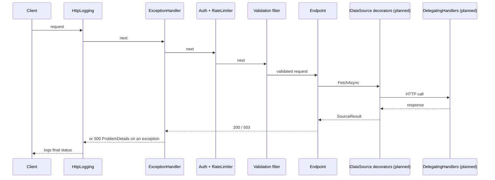
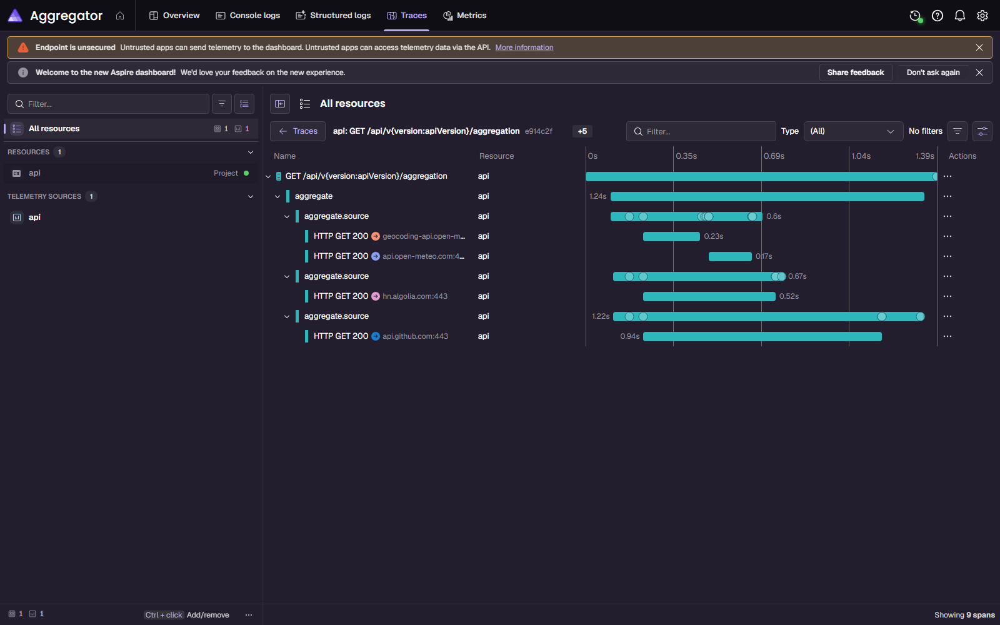
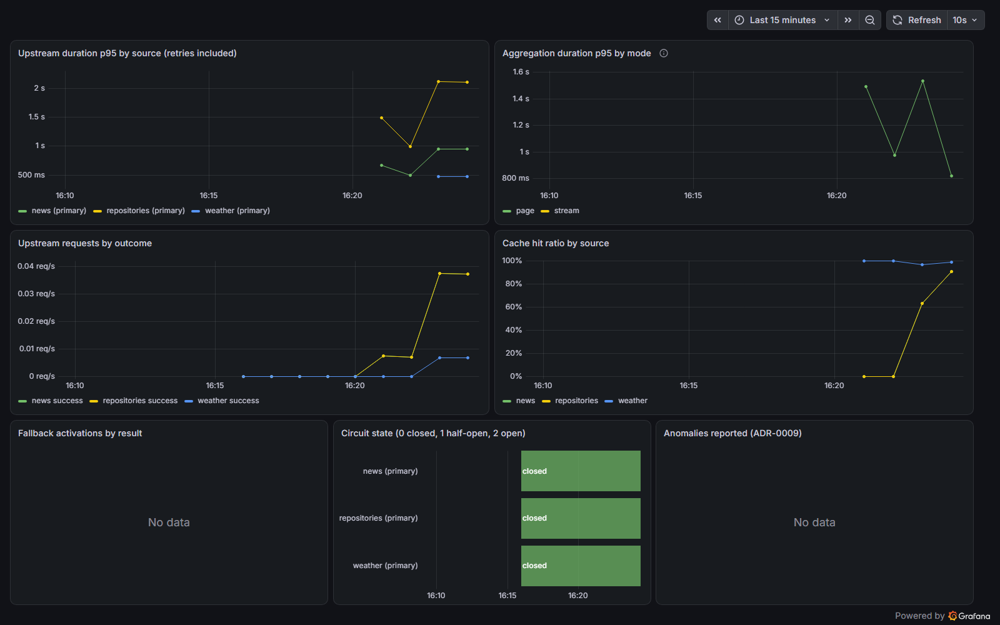
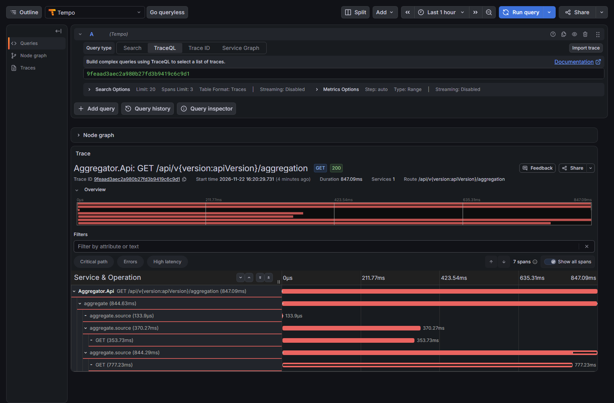

# AgileActors API Aggregator

ASP.NET Core 11 service that fans out to several external APIs, merges their results and exposes them through a single endpoint.

## Solution layout

Clean Architecture, ports-and-adapters rule: dependencies point inward.

```
src/
  Aggregator.Domain           entities, value objects, domain rules        → (nothing)
  Aggregator.Application      ports and use cases                          → Domain
  Aggregator.Infrastructure   source adapters, HTTP clients, cache, stats  → Application, Domain
  Aggregator.Api              endpoints, auth, OpenAPI, composition root   → all of the above
  Aggregator.ServiceDefaults  shared telemetry, health, resilience defaults
  Aggregator.AppHost          Aspire orchestration
tests/
  Aggregator.Domain.UnitTests
  Aggregator.Application.UnitTests
  Aggregator.Infrastructure.UnitTests
  Aggregator.Api.IntegrationTests
  Aggregator.ArchitectureTests  dependency rule, Domain purity, endpoint conventions
```

The dependency rule is enforced, not just documented: `Aggregator.ArchitectureTests` fails when a layer depends outward (ArchUnitNET) or when Domain references an assembly that does not load from the shared framework.

## HTTP API

Minimal APIs, versioned in the URL. Each feature is one sealed `IEndpoint` class under `Aggregator.Api.Endpoints`, found by an assembly scan, so a new endpoint needs no wiring.

| Method and path | Purpose | Scope | Responses |
|---|---|---|---|
| `GET /api/v1/aggregation` | Items from the selected sources, filtered, sorted and paged | `aggregation:read` | 200, 400, 401, 403, 429, 503 |
| `GET /api/v1/aggregation/stream` | The same, streamed as server-sent events per source | `aggregation:read` | 200, 400, 401, 403, 429 |
| `GET /api/v1/sources` | Registered sources and their categories | `aggregation:read` | 200, 401, 403, 429 |
| `GET /api/v1/statistics` | Request statistics per source | `stats:read` | 200, 401, 403, 429 |
| `GET /health/live`, `GET /health/ready` | Liveness and readiness probes (`Healthy` / `Unhealthy`) | anonymous | 200, 503 |
| `GET /openapi/v1.json` | OpenAPI 3.2 document; Scalar UI at `/scalar` in Development | anonymous | 200 |

An unknown version such as `/api/v2/…` is 404.

### Aggregation query

Every parameter is optional. Blank values count as missing, and names are matched ignoring case.

| Parameter | Meaning | Rules |
|---|---|---|
| `q` | Search text, passed to news and repositories in place of their configured query | at most 200 characters |
| `city` | Weather location; Open-Meteo looks it up with its keyless geocoding API, OpenWeatherMap takes it by name. An unknown city gives no weather items, not a failure | at most 100 characters |
| `sources` | Comma-separated source names, e.g. `news,repositories`; other sources are not called | unknown name → 400 |
| `category` | Keep only items of this category; sources that cannot serve it are not called | unknown, or not served by the selected sources → 400 |
| `from`, `to` | Inclusive `publishedAt` range, ISO 8601; a value without an offset is read as UTC. Also passed to sources that can filter by date | `from` after `to` → 400 |
| `sortBy` | `relevance` (default), `date` or `source` | other values → 400 |
| `sortOrder` | `desc` (default) or `asc` | other values → 400 |
| `page`, `pageSize` | Paging, applied after filtering and sorting | `page` ≥ 1; `pageSize` 1–100, default 20 |

Ties are broken deterministically: by date for `relevance`, by relevance for `date` and `source`, then by `id`. Example: `GET /api/v1/aggregation?q=rust&sources=news,repositories&sortBy=date&from=2026-11-01T00:00:00Z`.

**Relevance is a heuristic.** Each source scores its own items from 0 to 1, and the scores are not comparable across providers in any strict sense. News uses the upstream rank, repositories mix GitHub's search score with stars on a log scale, and weather favours readings closest to `from` (or now). Use it to order a mixed list, not as a measure of quality.

### Aggregation response

```json
{
  "items": [
    { "id": "news:4242", "source": "news", "category": "news", "title": "…", "summary": "…",
      "url": "https://…", "publishedAt": "2026-11-21T12:00:00+00:00", "relevance": 0.95,
      "details": { "$type": "news", "author": "dana", "points": 120, "publisher": null } }
  ],
  "sources": [
    { "name": "news",         "status": "Success",  "durationMs": 41.2, "error": null,           "ageSeconds": null },
    { "name": "weather",      "status": "Fallback", "durationMs": 3.1,  "error": null,           "ageSeconds": 90 },
    { "name": "repositories", "status": "Failed",   "durationMs": 5000, "error": "…unavailable", "ageSeconds": null }
  ],
  "paging": { "page": 1, "pageSize": 20, "totalCount": 3 }
}
```

`details` carries the source-specific fields, and `$type` says which shape follows: `weather` (`location`, `minTemperature`, `maxTemperature` in °C, `conditions`), `news` (`author`, `points`, `publisher`) or `repository` (`stars`, `forks`, `language`).

**A 200 can be degraded.** The status is 200 whenever at least one source produced data, live (`Success`), from cache (`Cached`) or as last-known-good data (`Fallback`, with its age). Read `sources[]` to see which sources failed. Only when every source fails, with no fallback, is the answer 503.

### Errors

Every error is an RFC 9457 `application/problem+json` body with a `traceId` that matches the distributed trace. A 503 also carries `sources[]`. Validation errors (400) are keyed by the query parameter name (`pageSize`, `sources`, `category`, `from`, `sortBy`, …). A 500 never contains exception details.

### Authentication and rate limiting

Every `/api/v1` route needs a JWT bearer token. The issuer, audience, lifetime and signing key are all validated. Get a development token with one command. It writes the issuer and audiences to `appsettings.Development.json` (tracked in the repository) and the signing key to user secrets only:

```bash
dotnet user-jwts create --project src/Aggregator.Api --scope aggregation:read --scope stats:read
```

Paste the printed token into Scalar's **Authorize** dialog, or send it as `Authorization: Bearer <token>`. Leave out a `--scope` to see a 403. The app refuses to start when no audience, or neither an authority nor a signing key, is configured, and the message names this command.

Validation settings live under `Authentication:Schemes:Bearer`, so a real identity provider is a configuration change, for example in a container:

```bash
Authentication__Schemes__Bearer__Authority=https://login.example.com/tenant/v2.0
Authentication__Schemes__Bearer__ValidAudiences__0=api://aggregator
```

Scopes are read from `scope` or `scp`, as separate claims or one space-separated value. Claims keep their JWT names (`MapInboundClaims = false`).

Each caller gets a token bucket, keyed by the JWT `sub`, or the client address when there is none: `RateLimiting:TokenLimit` (burst, default 20), `TokensPerPeriod` (10) and `ReplenishmentPeriod` (1 s). Over the limit the answer is 429 ProblemDetails with `Retry-After` in seconds. Health and OpenAPI are not limited. A 401 or 403 is answered before the limiter, so it does not use a token.

The gateway in front of the service owns what this instance does not: distributed limits, throttling anonymous floods, and TLS (ADR-0013). There is no `UseForwardedHeaders`, so behind a proxy every token without `sub` shares the proxy's bucket. If it is added, list `KnownProxies` explicitly.

### Contract tests

`tests/Aggregator.Api.IntegrationTests/Snapshots` pins the OpenAPI document and the 200, 503 and 400 bodies as `*.verified.json`. A contract change fails the test and writes a `*.received.json` next to it: review it and rename it to accept, or run with `AGGREGATOR_UPDATE_SNAPSHOTS=1` to overwrite all snapshots.

## Data sources

Every source implements the `IDataSource` port (Application) and is registered in Infrastructure with one line. The default configuration needs no API keys; setting a key switches that category to its keyed provider. The source name stays the same either way.

| Name | Without a key | With a key | Settings (`Sources:{name}:…`) |
|---|---|---|---|
| `weather` | Open-Meteo | OpenWeatherMap (`ApiKey`) | `Location`, `Latitude`, `Longitude`, `ForecastDays` (1–5) |
| `news` | Hacker News (Algolia) | NewsAPI (`ApiKey`) | `Query`, `MaxItems` (1–100) |
| `repositories` | GitHub, anonymous | GitHub (`Token`) | `Query`, `MaxItems` (1–100) |

Every source also accepts `BaseAddress`: it must be https (plain http only for loopback hosts), end with `/`, and carry no credentials. Options are validated at startup, so a bad value stops the app with a message naming the setting. Responses larger than 4 MB are refused.

Keys belong in user secrets, never in `appsettings*.json`:

```bash
dotnet user-secrets --project src/Aggregator.Api set "Sources:weather:ApiKey" "<openweathermap key>"
dotnet user-secrets --project src/Aggregator.Api set "Sources:news:ApiKey" "<newsapi key>"
dotnet user-secrets --project src/Aggregator.Api set "Sources:repositories:Token" "<github token>"
```

Being polite to upstreams:

- The standard resilience handler retries transient failures and honours `Retry-After`.
- GitHub requests send `If-None-Match`; a 304 reuses the stored body and does not count against the rate limit.
- `X-RateLimit-Remaining` is logged at Debug, and at Warning once 5 or fewer requests are left. A 429 logs its `Retry-After`.
- Outbound log entries redact query strings, so a key passed in the URL (OpenWeatherMap) is never logged. A test guards this.

An upstream failure never becomes a 500. Each source turns HTTP errors, timeouts, an open circuit and unreadable payloads into a short `SourceFailure` message for `sources[]` and logs the details. Only bugs in our own code surface as 500.

### How to add a data source

1. Create a folder under `src/Aggregator.Infrastructure/Sources/<Category>/<Provider>/`.
2. Add an options class that derives from `DataSourceOptions` and sets a default `BaseAddress` in its constructor. Use data annotations (`[Required]`, `[Range]`) for its other settings.
3. Add the DTO records and a `JsonSerializerContext` with `RespectNullableAnnotations` and `RespectRequiredConstructorParameters`, so a changed payload fails as `SourceFailure` instead of producing empty items.
4. Add an `internal sealed` class implementing `IDataSource` that builds the request and calls `SourceFetcher.FetchAsync` with a mapping to `AggregatedItem`. Use `SafeUri.Parse` for links.
5. Register it in `SourceRegistration`:

   ```csharp
   services.AddDataSource<MySource, MySourceOptions>("my-source");
   ```

   That line binds `Sources:my-source`, validates it at startup, and creates the named `HttpClient` with resilience and rate-limit logging. Chain `.AddConditionalRequests()` if the upstream supports ETags.
6. Add unit tests with MockHttp and a recorded fixture in `tests/Fixtures` (both test projects copy it), and add a WireMock case to `ExternalSourceTests`.

`ExternalSourceTests.FourthSource_ShouldBeListedAndAggregated_WhenRegisteredWithOneLine` registers a fourth source from the test project with that single line and checks it appears in `/sources` and `/aggregation`.

## Cross-cutting concerns

There is no mediator. Each concern has one home in an ASP.NET Core extension point, so endpoints contain business logic only. An architecture test fails if endpoint code uses `try` or depends on `Microsoft.Extensions.Logging`.

| Concern | Where it lives | Status |
|---|---|---|
| Access log | `UseHttpLogging`: method, path, status and duration in one entry. Query strings, headers and bodies are never logged, so tokens cannot leak. Health probes opt out where they are mapped (`WithHttpLogging(None)`). | done |
| Exception handling | `UseExceptionHandler` + `UnhandledExceptionHandler`: logs once with method and path, answers 500 ProblemDetails without details | done |
| Validation | `AddValidation`: requests reach the handler already validated, 400 ProblemDetails otherwise | done |
| Authentication, authorization, rate limiting | `UseAuthentication`, `UseAuthorization`, `UseRateLimiter`; the `/api/v1` group requires a signed-in caller and the `per-caller` limit, and each endpoint names its scope policy | done |
| Outbound resilience, rate-limit logs, conditional requests | Standard resilience handler plus `DelegatingHandler`s on each source's named `HttpClient` | done |
| Outbound statistics | `DelegatingHandler` on each source's named `HttpClient` | planned |
| Caching and telemetry around sources | decorators over `IDataSource` | planned |



HTTP logging is outermost on purpose. Inside the exception handler it would log a failed request as 200.

## Observability

All three OpenTelemetry signals are set up once in `Aggregator.ServiceDefaults` and exported over OTLP when `OTEL_EXPORTER_OTLP_ENDPOINT` is set. The resource carries `service.name` (the application name unless `OTEL_SERVICE_NAME` overrides it) and `service.version` (the MinVer version from the git tag). ASP.NET Core, HttpClient, runtime, Kestrel and Polly instrumentation is on, plus the Aggregator's own meter and activity source, both named `Aggregator`.

### Metrics

| Instrument | Type | Unit | Tags |
|---|---|---|---|
| `aggregator.source.request.duration` | histogram | s | `source`, `provider`, `outcome` |
| `aggregator.source.requests` | counter | `{request}` | `source`, `provider`, `outcome` (success, failure, cancelled, rejected) |
| `aggregator.cache.lookups` | counter | `{lookup}` | `source`, `result` (hit, miss, stale) |
| `aggregator.fallback.activations` | counter | `{activation}` | `source`, `result` (secondary, last_known_good, none) |
| `aggregator.aggregation.duration` | histogram | s | `mode` (page, stream), `outcome` (complete, degraded, failed, cancelled, error) |
| `aggregator.source.anomalies` | counter | `{anomaly}` | `source`, `provider` |
| `aggregator.source.circuit_state` | gauge | `{state}` | `source`, `provider`; 0 closed, 1 half-open, 2 open |

`provider` is `primary` or the secondary's name. Tags are low cardinality only: the caller's search text, city and other query values never become tags, span attributes or span names. Tests cover this. Outgoing URL query strings, where the OpenWeatherMap key travels, are redacted by .NET's HttpClient telemetry. Never set `DOTNET_SYSTEM_NET_HTTP_DISABLEURIREDACTION`; a test fails if the key reaches a span or a log.

### Traces

Every aggregation is one `aggregate` span (tags `aggregator.mode`, `aggregator.source_count`, `aggregator.outcome`) under the ASP.NET Core server span. Each source gets an `aggregate.source` child (tags `aggregator.source`, `aggregator.result`), and the HttpClient spans of that source's upstream calls sit beneath it, including on a cache miss. A fallback adds an `aggregator.fallback` event to the source span, and a circuit breaker that opens adds an `aggregator.circuit.opened` event to the span current at that moment. Logs written during a request carry its `TraceId` and `SpanId`.

### Where to look

- **Aspire dashboard (default).** `dotnet run --project src/Aggregator.AppHost` starts the API and the dashboard, which shows traces, metrics and structured logs with no further setup.
- **Grafana (optional).** `deploy/observability/compose.yaml` runs `grafana/otel-lgtm` (Grafana, Prometheus, Tempo, Loki and a collector) behind the `observability` profile. It provisions an *Aggregator* dashboard and an alert rule mirroring the anomaly rule (5-minute average above 1.5× the hourly average over at least 10 requests). The image signs everyone in as an anonymous admin, so its ports are bound to localhost.

  ```bash
  docker compose -f deploy/observability/compose.yaml --profile observability up -d
  OTEL_EXPORTER_OTLP_ENDPOINT=http://localhost:4317 dotnet run --project src/Aggregator.Api
  # Grafana: http://localhost:3000
  ```

### Sampling

Traces are always on by default, which suits local runs. Elsewhere set the standard variables, for example `OTEL_TRACES_SAMPLER=parentbased_traceidratio` and `OTEL_TRACES_SAMPLER_ARG=0.1`. Metrics are never sampled, so dashboards and alerts stay exact.

### Screenshots

One aggregation in the Aspire dashboard (taken with the dashboard's anonymous mode, hence the banner):



The provisioned Grafana dashboard and the same kind of trace in Tempo:





## Build and run

Requires the .NET 11 SDK (pinned in `global.json`).

```bash
dotnet build                                   # warnings are errors (Directory.Build.props)
dotnet test
dotnet user-jwts create --project src/Aggregator.Api --scope aggregation:read --scope stats:read   # once, before the first run
dotnet run --project src/Aggregator.AppHost     # Aspire dashboard + API
```

Package versions are managed centrally in `Directory.Packages.props`. Shared build settings (net11.0, nullable, warnings as errors) live in `Directory.Build.props`.

CI (`.github/workflows/ci.yml`) builds, checks formatting and runs the tests with coverage on every push and pull request to `main`. `.gitattributes` checks text out as CRLF, which `.editorconfig` expects, so the format check also passes on Linux.

## Package compatibility on net11.0

Checked on 2026-11-21 with SDK 11.0.100: restore and build produce no warnings.

| Package | Version | Note |
|---|---|---|
| Aspire.Hosting.AppHost / .Dotnet | 17.0.0 | `AddProject<T>` is obsolete; use `AddDotnetProject(name, path)` |
| Microsoft.Extensions.Http.Resilience / ServiceDiscovery | 11.0.1 | |
| Microsoft.AspNetCore.Authentication.JwtBearer | 11.0.0 | |
| OpenTelemetry.* | 1.21.0 | |
| xunit.v3.mtp-v2 | 4.0.3 | runs on Microsoft.Testing.Platform (`global.json` → `test.runner`) |
| Shouldly | 4.3.0 | |
| NSubstitute | 6.2.0 | |
| TngTech.ArchUnitNET.xUnitV3 | 0.13.5 | |
| Microsoft.AspNetCore.Mvc.Testing | 11.0.0 | |
| Microsoft.Testing.Extensions.CodeCoverage | 18.12.0 | `dotnet test -- --coverage` |
| Microsoft.AspNetCore.OpenApi | 11.0.0 | generates OpenAPI 3.2; built on Microsoft.OpenApi 3.x |
| Asp.Versioning.Http / .Mvc.ApiExplorer | 10.2.3 / 10.2.1 | net10.0 builds, work on net11.0 |
| Scalar.AspNetCore | 3.1.1 | reads the OpenAPI 3.2 document |
| Microsoft.Extensions.Http / Options.ConfigurationExtensions | 11.0.0 | Infrastructure only; the web app uses the shared-framework copies |
| Polly.Core | 8.7.0 | Infrastructure maps Polly's rejection exceptions to `SourceFailure`; 8.7.0 is what Aspire.Hosting 17 needs |
| RichardSzalay.MockHttp | 7.1.0 | HTTP in unit tests |
| WireMock.Net.Minimal | 2.32.0 | HTTP in integration tests |
| Microsoft.Extensions.Diagnostics.Testing | 11.0.1 | `FakeLogger` |
| BenchmarkDotNet | 0.15.8 | runs on .NET 11.0.0 with `InProcessEmitToolchain`, so it needs no generated project (checked 2026-11-22) |

Not used, and why:

- **Asp.Versioning.OpenApi 10.2.3** pins Microsoft.OpenApi 2.x, which conflicts with Microsoft.AspNetCore.OpenApi 11 (NU1107). The built-in generator reads the versioned ApiExplorer groups instead; analyzer warnings AV0029 / AV0030 are suppressed in `Aggregator.Api.csproj` with that reason.
- **Verify 33.7.1** fails the build (SponsorCheck SC021) unless the consuming project declares a maintenance-fee status. Snapshots use a small in-house helper (`JsonSnapshot`) instead.
- **Microsoft.Extensions.DependencyInjection.Abstractions** is available on net11.0 without a reference (NU1510).

- **WireMock.Net 2.32.0** (the full package) pulls in Microsoft.CodeAnalysis.CSharp 5.9 through its protobuf support, which conflicts with the 5.0 pin the architecture tests use (NU1109). `WireMock.Net.Minimal` has everything the tests need without it.

Still to check when it is added: Stryker.NET (with the mutation run in ADR-0014).
